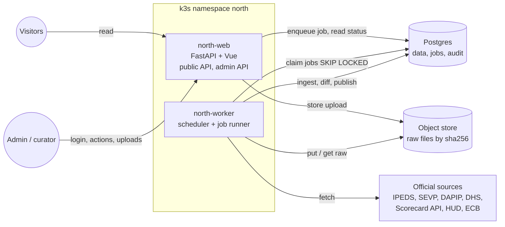
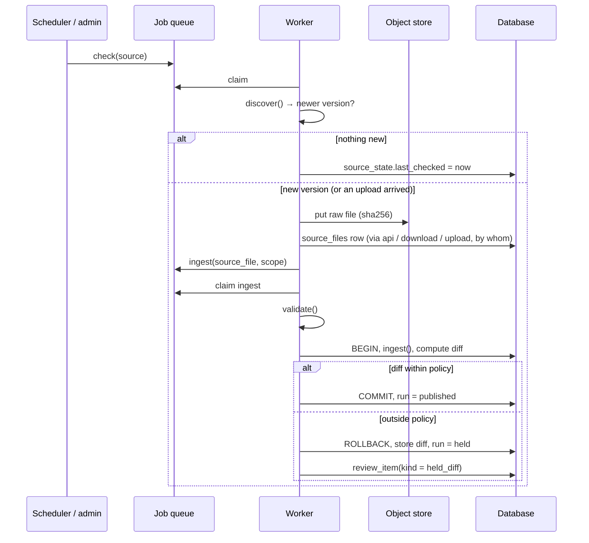

# Source sync, admin and review

The long-term shape of how North gets data in: official sources fetched on a schedule or uploaded by
hand, stored as immutable raw files, ingested by a worker, checked before they replace what is
published, and run from an admin area. Later phases (curation, LLM extraction) reuse the same
pieces.

**Status (2026-11-22).** Record [0006](../decisions/0006-admin-area-and-worker.md) built steps 1–3
of section 13: worker and Postgres queue, schedules, admin with login, uploads, audit log. Not built
yet: the object store (a PVC holds the raw files), diffs held for review (section 6), the review
queue (step 4), the database role split (section 9), API snapshot sources (step 5). Where this
document and record 0006 differ, the record wins (identity: password + TOTP, not GitHub OIDC).

## 1. Principles

| # | Principle | Consequence |
|---|---|---|
| P1 | **Fetching and uploading are the same thing.** | Both produce a raw file with a sha256. Ingestion only ever reads stored raw files, never the network. A source that blocks automated download is handled by hand without changing anything else |
| P2 | **Raw files are immutable and kept.** | Any value can be traced to the exact bytes it came from (NFR-01), and every version can be re-ingested after a parser fix without downloading again |
| P3 | **The web process never does heavy work.** | Downloads, parsing and loading run in a separate worker with its own memory limit. The public site stays up if a parser exhausts memory or a source hangs |
| P4 | **Nothing replaces published data blindly.** | Each ingestion computes a diff against what is live. Small, expected diffs publish on their own; large or suspicious ones wait for a person |
| P5 | **One review queue for everything a person must decide.** | Unmatched SEVP rows, held diffs, and later pilot data and LLM extraction candidates all go through the same queue, with the same audit trail |
| P6 | **Least privilege everywhere.** | The public web role cannot change program data; only the worker can. The admin requires login with roles. Secrets never show in the UI |
| P7 | **Polite, honest clients.** | A user-agent that names the project, conditional requests, backoff, no browser impersonation. A source that blocks us is reported as blocked and falls back to upload |
| P8 | **Country-neutral core.** | Sources are adapters under `ingest/<country>/`. The admin groups them by country and never names one in code |

## 2. Why a separate worker (and not a task in FastAPI)

FastAPI being asynchronous means **waiting** on a slow site does not block other requests. The
risks are elsewhere:

- **Memory.** Parsing the SEVP PDF or a 200 MB Scorecard CSV inside the web pod (limit 512 Mi, one
  replica) can get it OOM-killed. The site is down until it restarts.
- **CPU.** PDF and CSV parsing is CPU-bound; it holds the GIL and the event loop does not help.
  Our handlers and the loader are also synchronous (SQLAlchemy sync), so they run in a small thread pool.
- **Lifecycle.** A deploy or restart kills the work in progress with no retry and no record.
  Cloudflare cuts requests at 100 s anyway, so a long ingestion cannot be one HTTP request.
- **Privilege.** The process that writes program data should not be the one exposed to the internet.

So the web process only **enqueues** work and **reads** its progress; the worker does it.

## 3. Components



| Component | What it is |
|---|---|
| `north-web` | The current Deployment. Public read API, plus `/api/admin/*` behind login. Accepts uploads (streams them to the object store, size-capped) and enqueues jobs. No egress to the internet (NetworkPolicy), which also closes SSRF |
| `north-worker` | Same image, command `python -m north.worker`. One replica. Runs the scheduler and the job loop. Has egress to the internet and to the object store |
| Job queue | A Postgres table claimed with `SELECT … FOR UPDATE SKIP LOCKED`. No Redis or broker: jobs are transactional with the data they change, and backup covers them |
| Scheduler | Inside the worker, holding a Postgres advisory lock so only one runs. Enqueues `check` jobs from each source's cadence (declared in code; the admin can pause a source or run it now) |
| Object store | S3-compatible bucket `north-raw` (MinIO in the cluster, or a PVC behind the same interface). Key `sha256/<ab>/<sha256>`. Write-once; included in backups |

## 4. Source adapters

Each source is a class in `ingest/<country>/sources/` implementing one interface. The registry is
code (reviewed in pull requests); the database keeps only state.

| Member | Meaning | Example (IPEDS HD) |
|---|---|---|
| `id`, `country`, `title`, `license`, `docs` | identity, shown in the admin | `ipeds_hd`, US, link to `docs/sources/ipeds.md` |
| `channel` | `api`, `download`, `upload_only` | `download` |
| `cadence` | when to check, and when a release is expected | weekly check; new year each autumn |
| `secrets` | names of the secrets it needs (never values) | none; Scorecard: `NORTH_API_DATA_GOV_KEY` |
| `discover()` | cheap check for a newer version: next-year probe, link on a data page, ETag / Last-Modified, Federal Register search | probe `HD<year+1>.zip` |
| `fetch(version)` | bytes of that version, with conditional requests and retries | `HD2025.zip` |
| `identity(bytes)` | the content hash used for idempotency. Usually the file sha256; for files regenerated on every download (the DAPIP zip changes hash each time), the hash of the extracted CSVs | sha256 of the zip |
| `validate(file)` | structural checks before ingestion: columns, row counts, dictionary values, zip limits | `AWLEVEL 7` is "Master's degree" |
| `ingest(file, scope)` | the existing loaders (`ipeds.py`, `sevp.py`, …), unchanged in spirit | `ipeds.load_hd` |
| `diff_policy` | thresholds for auto-publish (section 6) | institutions removed ≤ 2 % |

API sources (Scorecard, HUD, ECB) are fetched into a **snapshot file** (JSON lines, sorted, with the
query that produced it) and stored like any download. That keeps P1 and P2 true for APIs too: an API
answer is evidence with a sha256, not a transient call.

## 4a. Fetching on the VPS, APIs included

Everything that reaches the network runs **in the cluster**, never from a laptop: a laptop copy is the
upload fallback (P1), not the normal path. Two stages, so the VPS starts pulling data before the
worker of step 1 exists.

### Stage 0: a CronJob around `cli sync` (before the worker)

`north.ingest.us.fetch` and `cli sync` already do fetch → raw directory → load. Stage 0 only
schedules them:

| Piece | Value |
|---|---|
| CronJob `north-sync` | same image as the Deployment, `python -m north.ingest.us.cli sync --raw /data/raw --state ALL`, weekly (Monday 06:00 UTC), `concurrencyPolicy: Forbid`, `backoffLimit: 0`, `activeDeadlineSeconds` 2 h |
| Raw store | PVC `north-raw` (5 Gi, RWO) mounted at `/data/raw`, layout of `fetch.py`. It becomes the PVC backend of the object store interface in step 1, so nothing is moved later |
| Exit code | `0` all fresh; `EXIT_ATTENTION` a source blocked, missing or changed (data still loaded from what is on disk); `1` load failed. The CronJob history shows which |
| Memory | limit 2 Gi (SEVP PDF parse); the web pod is untouched (P3) |
| Database | the DML role, as the load Job does today |

What it does not give: diffs held for review (P4), per-source cadence, the admin view. Those are step
1. A held diff is not possible yet, so stage 0 runs only the sources that already load idempotently
(IPEDS, SEVP, DAPIP, DHS check).

### API sources

An API answer is stored as a **snapshot file** and ingested from disk like any download (P1, P2):

- JSON Lines, one record per line, sorted by a stable key, with a first header line
  `{"source", "endpoint", "params", "fetched_at", "pages", "records"}`.
- `params` never contains the key: keys go in a header (`X-Api-Key`, `Authorization: Bearer`),
  never in the URL, so they also stay out of the manifest, logs and `source_url`.
- **Identity** = sha256 of the records without the header (as for DAPIP). The same answer on another
  day is "unchanged", not a new version.
- Paging and quotas live in the adapter: a request budget per run, a pause between pages, stop and
  report `failed` on 429 (never retry in a loop). A partial snapshot is discarded, never stored.
- Path: `raw/<source>/<source>-<version or date>.jsonl`.

| Source | Channel on the VPS | Key | Cadence | Notes |
|---|---|---|---|---|
| ECB reference rates | API (SDMX CSV) | none | daily after 16:00 CET, last 10 days | idempotent upsert into `fx_rates` (docs/sources/exchange-rates.md) |
| Federal Register | API | none | weekly | **discovery only**: a new "STEM Designated Degree Program List" notice opens a review item to rebuild the DHS reference CSV; it never changes data by itself |
| College Scorecard FoS | **bulk zip** found on the data page; API as fallback | api.data.gov key (fallback only) | weekly check, several releases a year | same data in both channels (spike S-1); the bulk file has a versioned name and needs no key. The API is used when the link is not found, or for a single institution |
| HUD FMR | API (`/fmr/statedata/<state>`, 51 calls a year) | HUD User token | monthly check, new year by October 1 | the xlsx is blocked by a WAF challenge (section 12). Limit 60 requests per minute and a non-endorsement notice, to confirm on HUD's site when the token is created |
| IPEDS, SEVP, DAPIP, DHS PDF | download (`fetch.py`) | none | weekly | already implemented |

### Keys in the cluster

- One Secret `north-api-keys` (`NORTH_API_DATA_GOV_KEY`, `HUD_API_TOKEN`), committed **sealed** to
  `k3s-gitops/manifests/north/` with Sealed Secrets, like the other apps. Mounted only in the sync
  CronJob (later the worker), never in the web Deployment.
- A missing key is a health state (`needs key`), not an error: the source is skipped, the others run.
- The api.data.gov key is the one in the local `.env`. The HUD token needs a free HUD User account,
  created by the author.

### Network

- Today the namespace blocks ingress and allows all egress. Add a policy so that only pods labelled
  `north-egress: "true"` (the sync CronJob, later the worker) reach the internet on 443, and the web
  Deployment reaches only Postgres and DNS (section 3, SSRF).
- Kubernetes NetworkPolicy cannot filter by host name, so the allowlist of hosts is in code (each
  adapter declares its hosts; the fetcher refuses any other URL, redirects included).

## 5. Flow of one version



- Ingestion runs in one transaction, so the public site sees either the old data or the new, never
  a half-loaded file.
- A held version is re-run with "approve" by an admin: the file is immutable, so the result is the
  same one the admin reviewed.
- Re-ingest (after a parser change) is a job on an existing `source_file`; nothing is downloaded.

## 6. Diff and publish policy

The diff is stored per run as structured data (counts plus samples), for example:

```json
{ "institutions": {"added": 1, "removed": 0, "changed": 12},
  "programs": {"added": 3, "removed": 1},
  "values": {"graduate_tuition_nonresident": {"changed": 40, "max_change_pct": 7.5}},
  "statuses": {"to_unknown": 0, "to_confirmed_negative": 0} }
```

Default policy (each adapter may tighten it):

| Change | Auto-publish when |
|---|---|
| rows removed (institutions, programs, campuses) | ≤ 2 % and ≤ 10 rows |
| any value becoming `confirmed_negative` | never automatic |
| known values becoming `unknown` | ≤ 1 % |
| numeric change (tuition, counts) | ≤ 25 % per value |
| first load of a source | automatic (nothing to compare with) |

`field_changes` (already in the schema) keeps the per-value history the diff summarises.

## 7. Admin area

Same application, route `/admin` (a lazy-loaded part of the Vue app, not indexed), API under
`/api/admin`. Screens:

| Screen | Shows | Actions (role) |
|---|---|---|
| **Sources** (home) | one row per source, grouped by country: channel, last check, last new version, next expected release, health (`fresh`, `stale`, `blocked`, `failing`, `paused`, `needs key`), quota use for APIs | check now, pause/resume (admin) |
| **Source detail** | versions (sha256, size, how it arrived, by whom, date), runs with their diffs, adapter docs link, secrets present or missing (never values) | ingest a version, re-ingest, approve a held diff (admin) |
| **Upload** | drag a file, the source is detected from its name and content, validation result before anything is ingested | upload (curator), ingest (admin) |
| **Runs** | queue and history with live progress (Server-Sent Events from the job row), logs, timings | cancel, retry (admin) |
| **Review queue** | one list for: SEVP reconciliation tasks, held diffs, and later pilot rows and LLM extraction candidates, each with evidence and the official link | match / reject / confirm with evidence (curator), approve (admin) |
| **Audit log** | who did what, when, from which job | read only (admin) |
| **Users** | accounts and roles | grant, revoke (admin) |

The public site gets a **Sources** page from the same data: for each source, the version in use
and its date, last checked, and a link to the official file. This is the user-facing side of
NFR-01, so visitors can see how fresh the data is.

## 8. Identity and access

- **Username, password and TOTP**, implemented in the app (record 0006/X1; the earlier proposal of
  GitHub OIDC was replaced by the author's choice). Accounts exist only when an admin creates them;
  there is no self sign-up.
- **Roles** in the database: `admin` (everything), `curator` (upload, work the review queue),
  `viewer` (read the admin, for audits). Checked server-side on every `/api/admin` call.
- **Session**: server-side session row, cookie `HttpOnly; Secure; SameSite=Strict`, 12 h idle
  limit; CSRF token on every state-changing request; rate limit on login and uploads.
- **Second layer (recommended)**: Cloudflare Access in front of `/admin` and `/api/admin`, since the
  site already sits behind Cloudflare. It stops anonymous traffic before it reaches the app.
- Every admin action is written to `audit_log` with the user, the job and the request id.

## 9. Database roles

| Role | Can | Used by |
|---|---|---|
| `north_owner` | DDL (migrations) | migration initContainer only |
| `north_worker` | DML on data tables, jobs, runs, review items | the worker |
| `north_web` | SELECT on data; DML only on admin tables (jobs it enqueues, sessions, users, review decisions, audit) | the web Deployment |

A compromised public pod then cannot alter program data. This needs a third role in the
`Banco` composition of `k3s-gitops` (today it creates two).

## 10. Data model additions

| Table | Purpose |
|---|---|
| `source_files` (exists) | add `storage_key`, `channel` (`api`, `download`, `upload`), `content_identity`, `discovered_url`, `fetched_by` |
| `source_state` | per source: paused, last_checked, last_new_version, ETag / Last-Modified, consecutive failures, health |
| `jobs` | queue: kind (`check`, `fetch`, `ingest`, `reingest`, `approve`), payload, status, attempts, run_after, locked_by, heartbeat, log |
| `ingestion_runs` (exists) | add `diff` (JSONB), `published` / `held` / `rejected`, `job_id` |
| `review_items` | one queue: kind (`sevp_match`, `held_diff`, `pilot_row`, `extraction`), subject, payload, evidence, status, decided_by, decided_at. `reconciliation_tasks` migrates into it |
| `users`, `user_roles`, `sessions` | identity (OIDC subject, never a password) |
| `audit_log` | append-only: actor, action, target, job, request id, time |

## 11. Notifications

The worker sends an event to one outbound webhook (a secret URL) for: a new version published, a
diff held, a source blocked or failing three times in a row, a key missing or expiring. Where it goes
(n8n, e-mail, WhatsApp) is configured outside North.

## 12. What the fetch test showed (2026-11-21, from the author's machine)

Run with `deploy/k8s/fetch-sources-test.yaml`; to repeat from inside the cluster.

| Source | Result |
|---|---|
| IPEDS HD, C_A, IC_AY 2023 + dictionaries | downloaded (honest user-agent works now) |
| IPEDS next releases (HD2025, C2025_A, IC2024_AY) | 404, not published yet: the probe is the discovery method |
| SEVP certified list | link found on the search page, PDF downloaded, same file as the local copy |
| DHS STEM PDF | downloaded, sha256 equals the reference meta |
| Federal Register API | works; finds the STEM list notices (2023, 2024) |
| DAPIP | downloaded; **the zip's sha256 changes on every download**, so its identity must be the extracted CSVs (section 4) |
| Scorecard bulk + data page | reachable; API not tested yet (needs the key as a cluster secret) |
| HUD FMR xlsx | **blocked**: HTTP 202 with an empty body (a bot challenge). Use the HUD API with a token, or upload |
| ECB rates, Census gazetteer | work |

**Repeated from inside the cluster (2026-11-22, VPS IP):** same results, with one difference: the
Scorecard data page answers 403 to the datacenter IP. North does not load from that page; Scorecard
goes through the API with the key (section 4a). The SEVP list found was `certified-school-list-11-18-26.pdf`.

## 13. Implementation order

Each step ships on its own and leaves the system working.

0. **Scheduled sync on the VPS (section 4a, stage 0).** Repeat the fetch test from inside the cluster, then the
   `north-sync` CronJob, the `north-raw` PVC, the sealed `north-api-keys` and the egress policy.
1. **Worker and queue, no UI.** `jobs`, `source_state`, object store, worker Deployment, adapters for
   the sources we already load, scheduler, diff and policy, the webhook. The CLI becomes "enqueue and
   wait", so local and production run the same path. Third database role.
2. **Login and a read-only admin.** OIDC, roles, sessions, audit, Sources / Source detail / Runs
   screens, public Sources page.
3. **Admin actions.** Check now, pause, upload, ingest, re-ingest, approve held diffs.
4. **Review queue.** `reconciliation_tasks` moves into `review_items`; the SEVP matching screen.
5. **New sources.** Scorecard (API snapshot), HUD (API with token), ECB rates, each as an adapter.
6. **Curation and extraction.** Pilot rows and LLM extraction candidates enter the review queue as
   `extracted_unverified`; a curator confirms them with evidence (`reported_by_program`).

## 14. Open decisions for the author

| # | Question | Recommendation |
|---|---|---|
| O1 | Identity provider | **decided (0006/X1):** password + TOTP in the app; Cloudflare Access in front of the admin still recommended |
| O2 | Raw file store | MinIO bucket in the cluster (S3 API, versioning, backup); a PVC is acceptable for step 1 behind the same interface |
| O3 | Third database role | yes; add it to the `Banco` composition |
| O4 | Notification channel | one webhook to n8n, routing done there |
| O5 | Auto-publish thresholds | the defaults in section 6, tuned after the first months |
| O6 | Scorecard channel | bulk zip as the version of record, API as fallback |
| O7 | HUD token | the author creates a free HUD User account; until then HUD is upload only |
| O8 | Stage 0 before the worker | yes: the VPS pulls weekly now, and the worker replaces the CronJob later without moving the raw files |
