# UML Model — North

Diagrams built from the SRS, **before** the code structure. They fix the vocabulary (class, state and message names) that later becomes tables, modules and endpoints. They are written in Mermaid, which GitHub renders directly in the repository.

Reading order: use cases → domain → states → activities → sequences → components → deployment → physical model.

> **Version 1.0 (baseline).** Applies decision record 0002 (`docs/decisions/0002-after-data-spikes.md`, R1–R18, 0002/A1–A16, K1–K7). Names follow the record; when this model and the record disagree, the record wins. Changes from 0.3:
> - **Location:** new `Campus` and `Locality` (R17); each program belongs to one campus; SEVP authorization moved from `Institution` to `Campus` (R5, R11, K7); HUD rent stored once per county in `RentBenchmark` (R6, K5).
> - **Official files by upload:** new `SourceFile` / `source_files` (R4, FR-26); `IngestionRun` points to it; idempotency on `(source, sha256)`. Sequence 5.1 rewritten (IPEDS first, R3); new sequence 5.5 (upload). Components and deployment get an upload volume.
> - **VerifiedValue:** new `source_kind` (R13); polarity rule (R12); source rules for `confirmed_negative` and `extracted_unverified` (0002/A4).
> - **Program:** `funding` is an object (0002/A6); deadlines are a list of `VerifiedValue` (R18); primary classification is verified (0002/A7); `in_strategy` is derived (0002/A11); derived flag `no_stem_opt_extension` for 52.12 (R1).
> - **Rules and reference data:** `ProgramEligibility` gets `result`, `rule_version`, `claim_mismatch` (0002/A8); `EligibilityRule.params` (0002/A14); `ClassificationMap.origin/partial/notes` (R9); `FxRate.source` = `ecb` (R8); institutional accreditation shape (R10); `Institution.carnegie_classification` (0002/A12); `dapip` identifier scheme (0002/A15).
> - **Profile and evaluation:** English score or target (R14); budget is a whole-program total (K2); `Evaluation` gets `score_range`, `certainty`, breakdown (0002/A9, R16); filter outcome `pass_with_caveat` (K3); `CostEstimate.period_total_with_competitive_funding` (R15).
> - Scope CIPs: 11.xx, 52.12xx (flagged), 30.70xx, 30.71xx (R1, R2). Pending items updated.

> **Version 1.1 (record 0008).** English placement, Ireland and every degree level:
> - **Program:** `kind` (`degree`, `language_course`) and `level` (ISCED 2011 level + credential) (T12, T13); `language_course` fields (CEFR entry/exit, exam, weeks, hours, price, start dates); program-level `intl_authorization` for Irish lists (T5).
> - **Ireland:** `IeRules` beside `UsRules`; `CountryRules.family()` (T2); schemes `ie_ilep`, `ie_trusted` (authorization), `ie_ilep_ref`, `ie_trusted_ref`, `ie_irq` (program identifiers, new `program_identifiers` table), `ie_provider_no` (institution), `ie_nfq` and `us_ipeds_awlevel` (classifications), `ie_cso_riq02`, `ie_county` (localities); `RentBenchmark.period` (T6, T7).
> - **Curation slices** (T11): `CurationSlice` / `curation_slices`; coverage moves from subdivision to slice.
> - **Profile:** `travelling_party` (T2) and `english.estimated` (T23); seven tests in `EnglishScore` (T17); `toefl_ibt_scale` on program minimums (T20).
> - **Placement:** `PlacementItem` and `PlacementResult` (T21–T23); items live in YAML in the repo, results in the browser, so neither is a table.
> - Use case UC12; reconciliation kind `ie_list_move`.

> **Multiple countries (v0.2, C-09).** The model accepts any country without data migration: institution identifiers, program classification, authorization for foreign students, work eligibilities, localities and currency are generic, and visa rules live in one module per country. The `us` and `ie` modules are in scope (record 0008). In the diagrams, "state" is the country's **subdivision** (the state in the US, the province in Canada).

| # | Diagram | Answers | Requirements |
|---|---|---|---|
| 1 | Use cases | who does what | SRS §7 |
| 2 | Domain classes | what the system stores and computes | BR-01, BR-02, BR-07, C-09 |
| 3 | States | how a data point and an extraction change status | BR-02, BR-03, BR-10 |
| 4 | Activities | how the elimination filter decides | BR-04, FR-18 |
| 5 | Sequences | the order of calls in the critical flows | UC04, UC05, UC06, UC08, FR-26 |
| 6 | Components | how the code is split | §1.5, C-01 to C-03 |
| 7 | Deployment | where each piece runs | C-08 |
| 8 | Physical model (ER) | the Postgres tables | C-03, FR-09, C-09 |

---

## 1. Use cases

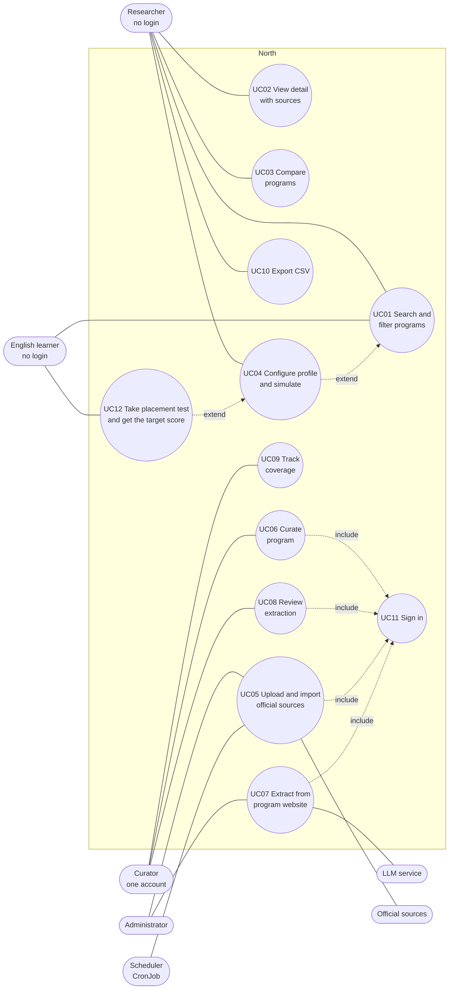

- In the MVP, curator and administrator are **the same account** (Q02). The roles stay separate in the model so it does not need to change when more people join.
- UC11 (login) is new in SRS 1.0, because of A1 (curation in the database). It covers FR-25. Record 0006 implements it as username + password + TOTP; the `accounts` entity below is the `users` table, with `admin_sessions`, `login_attempts`, `audit_log`, `jobs`, `job_logs` and `schedules` next to it. Record 0007 adds `users.email`, `users.email_verified_at`, `users.locale`, `users.notify_jobs`, and the tables `user_tokens` (single-use email links) and `email_outbox` (messages the worker sends).
- The scheduler triggers UC05 without login only because it runs inside the cluster, with its own credential (see §7). It runs only sources that allow automatic download (today: ECB rates) and re-processes the latest uploaded files when rules change (K4).
- UC12 (record 0008) runs fully in the browser: items and audio are static files, the result stays local and becomes the profile's estimated band (FR-28, FR-29, FR-35).
- UC05 now starts with an upload: the administrator downloads each official file in a browser and uploads it in the curation screen (FR-26, R4). Every source except ECB rates enters this way.

---

## 2. Domain classes

```mermaid
classDiagram
  direction LR

  class Country {
    code: str  «US, CA, GB»
    name: str
    currency: str  «USD»
    rules_module: str  «us»
  }
  class Subdivision {
    code: str  «US-TX»
    name: str
    status: CoverageStatus
  }
  class Institution {
    id: slug
    name: str
    city: str
    control: public / private
    accreditation: VerifiedValue~Accreditation~
    carnegie_classification: VerifiedValue~str~
  }
  class Accreditation {
    accreditor: str
    scheme: str  «us_ed_recognized»
    institutional: bool  «always true»
  }
  class InstitutionIdentifier {
    scheme: str  «unitid, opeid, dapip, ror, ie_provider_no»
    value: str
  }
  class ProgramIdentifier {
    scheme: str  «ie_ilep_ref, ie_trusted_ref, ie_irq»
    value: str
  }
  class Campus {
    name: str
    city: str
    locality: Locality
    sevp_campus_code: str or null
    latitude: decimal or null
    longitude: decimal or null
    intl_authorization: VerifiedValue~Authorization~
  }
  class Locality {
    country: str  «US, IE»
    scheme: str  «us_county_fips, ie_cso_riq02, ie_county»
    code: str  «48453»
    name: str
  }
  class RentBenchmark {
    locality: Locality
    source: str  «hud_fmr, cso_riq02»
    period: str  «FY2027, 2025Q4»
    bedrooms: int  «0 to 4; 4 = 4+ in Ireland»
    amount: Money  «monthly»
  }
  class Authorization {
    scheme: str  «sevp, ie_ilep, ie_trusted»
    level: campus / program
    authorized: bool
    valid_until: date or null  «ILEP end, T6»
  }
  class Program {
    id: slug
    name: str
    kind: degree / language_course
    level: VerifiedValue~Level~  «null for language courses»
    degree: str  «MS, MEng, MSc, MRes»
    modality: VerifiedValue~Modality~
    intl_authorization: VerifiedValue~Authorization~ or null  «program level, ie»
    language_course: LanguageCourse or null
    primary_classification: VerifiedValue~Classification~
    in_strategy: bool  «derived»
    flags: set~str~  «derived, no_stem_opt_extension»
    immigration: dict  «keys from the country module»
    academic: dict
    cost: dict  «values in Money»
    funding: Funding
    admissions: dict  «deadlines: list of VerifiedValue of Deadline»
    career: dict
    family: dict
  }
  class Level {
    isced_level: 5 / 6 / 7 / 8
    credential: certificate / associate / bachelor / postgraduate_certificate / master / doctorate_research / doctorate_professional
  }
  class LanguageCourse {
    cefr_entry: VerifiedValue~CefrBand~
    cefr_exit: VerifiedValue~CefrBand~
    exam: VerifiedValue~str~  «ielts, cambridge, trinity, languagecert, toefl, pte, duolingo, tie, other»
    weeks: VerifiedValue~int~
    hours_per_week: VerifiedValue~decimal~
    price: VerifiedValue~Money~
    start_dates: list~VerifiedValue~  «each a date»
  }
  class CurationSlice {
    name: str  «Texas tech master's, Dublin English courses»
    country: str
    filter: dict
    created_by: Account
  }
  class Funding {
    available_to_masters: VerifiedValue~bool~
    opportunities: list~FundingOpportunity~
  }
  class Deadline {
    term: fall / winter / spring / summer
    term_year: int
    applicant: international / domestic / all
    kind: priority / final / funding_consideration / rolling
    date: date or null
  }
  class Classification {
    scheme: str  «cip2020, isced_f_2013, us_ipeds_awlevel, ie_nfq»
    code: str  «11.0701»
    title: str
  }
  class ClassificationMap {
    from: Classification
    to: Classification  «CIP to ISCED-F»
    origin: derived_official / proposed
    partial: bool
    notes: str
  }
  class EligibilityRule {
    key: str  «us.stem_opt»
    version: str  «2024-07-22»
    published_on: date
    source_url: str
    params: dict  «whole_series 14, 26, 27, 40»
  }
  class ProgramEligibility {
    <<derived>>
    result: VerifiedValue~bool~
    rule_version: str
    claim_mismatch: bool
    computed_at: datetime
  }
  class VerifiedValue~T~ {
    value: T or null
    status: VerificationStatus
    source_kind: SourceKind or null
    source_url: str or null
    evidence: str or null
    verified_at: datetime or null
  }
  class VerificationStatus {
    <<enumeration>>
    confirmed_official
    reported_by_program
    extracted_unverified
    unknown
    confirmed_negative
  }
  class SourceKind {
    <<enumeration>>
    page
    official_list
    correspondence
    uploaded_file
  }
  class Money {
    amount: decimal
    currency: str  «ISO 4217»
  }
  class FxRate {
    base: str  «EUR»
    quote: str
    rate: decimal
    on_date: date
    source: str  «ecb»
    source_url: str
  }
  class CountryRules {
    <<interface>>
    criteria(program, profile) list~CriterionResult~
    eligibilities(program) list~ProgramEligibility~
    flags(program) set~str~
    migration_risk(program) Risk
    household_income(profile) Money
    family(program, profile) CriterionResult
    bands() ScoreBands
  }
  class UsRules {
    SEVP on campus + I-20 on program
    F-1 modality
    us.stem_opt
    F-2 cannot work
    ESL: F-1, 24 months, no OPT
  }
  class IeRules {
    programme on ILEP or TrustEd
    Stamp 2: no dependants
    NFQ 10 research: Stamp 2A, spouse cannot work
    EUR 10,000 a year
  }
  class FieldChange {
    field_path: str  «admissions.english.toefl_ibt_min»
    old: VerifiedValue
    new: VerifiedValue
    author: str  «account or ingest:source»
    at: datetime
  }
  class MigrationRule {
    key: str  «us.grace_period_days»
    summary: str
    last_checked_at: date
    source_url: str
    affects: list~field_path~
  }
  class SourceFile {
    source: str  «ipeds_c_a, dhs_stem, sevp, dapip, scorecard_fos, hud_fmr, ie_ilep, ie_trusted, ie_irq, cso_riq02»
    file_version: str  «C2024_A, 2024-07-22»
    sha256: str
    uploaded_by: Account
    uploaded_at: datetime
  }
  class IngestionRun {
    source_file: SourceFile
    status: running / succeeded / failed
    started_at: datetime
    counts: dict
    errors: list
  }
  class ReconciliationTask {
    reason: str  «SEVP without exact match, ie_list_move, value conflict»
    candidates: list
    resolved: bool
  }
  class RawPage {
    url: str
    fetched_at: datetime
    content_hash: str
    markdown: text  «internal use, Q08»
  }
  class Extraction {
    model: str
    tokens: int
    cost_usd: decimal  «LLM cost»
    status: ExtractionStatus
  }
  class ExtractedField {
    field_path: str
    value: any
    evidence: str
    decision: accepted / corrected / rejected / pending
  }
  class Account {
    email: str
    roles: set~Role~
  }
  class Profile {
    <<transient>>
    budget: Money  «whole program, K2»
    english: EnglishInput
    dependents: int
    spouse_can_work: bool
    travelling_party: dict  «language_course alone, degree with_family; T2»
    undergrad_area: str
  }
  class EnglishInput {
    score: EnglishScore or null  «real score»
    target: EnglishScore or null  «R14, when there is no score»
    estimated: PlacementResult or null  «T23»
  }
  class EnglishScore {
    test: toefl_ibt / ielts_academic / cambridge / duolingo / pte_academic / languagecert / trinity_ise
    scale: str or null  «ibt_0_120, ibt_1_6»
    overall: decimal
  }
  class PlacementResult {
    <<browser>>
    bands: dict  «grammar, vocabulary, reading, listening»
    overall: CefrBand
    taken_at: datetime
    bank_version: str
  }
  class PlacementItem {
    <<file>>
    id: str
    skill: grammar / vocabulary / reading / listening
    band: A2 / B1 / B2 / C1
    audio_file: str or null
  }
  class Weights {
    post_study_work: 20  «STEM OPT in the US»
    cost: 20
    funding: 15
    admissibility: 15
    career_roi: 15
    family: 10
    quality: 5
  }
  class Evaluation {
    <<computed>>
    filter: FilterResult
    score: 0..100
    score_range: min..max
    certainty: 0..100 percent
    breakdown: list~CriterionScore~
    migration_risk: low / medium / high
    cost: CostEstimate
    finalist_eligible: bool
  }
  class CriterionScore {
    criterion: str  «cost»
    weight: int
    score: 0..100  «unknown = 50»
    known_share: 0..1
  }
  class FilterResult {
    outcome: pass / pass_with_caveat / fail / undetermined
    criteria: list~CriterionResult~
  }
  class CriterionResult {
    criterion: str
    outcome: pass / pass_with_caveat / fail / undetermined
    reason: str
  }
  class CostEstimate {
    tuition_fees: Money
    i20_requirement: Money  «visa financial requirement»
    living_cost: Money
    rent_benchmark: RentBenchmark
    period_total_net: Money  «guaranteed funding only»
    period_total_with_competitive_funding: Money
    fx_used: list~FxRate~
    sources: dict
  }

  Country "1" --> "*" Subdivision
  Country "1" --> "*" Locality
  Subdivision "1" --> "*" Institution
  Institution "1" *-- "*" InstitutionIdentifier
  Institution ..> Accreditation
  Institution "1" --> "*" Campus
  Campus "*" --> "1" Locality
  Campus ..> Authorization
  Campus "1" --> "*" Program
  Program "1" *-- "*" ProgramIdentifier
  Program ..> Level
  Program ..> LanguageCourse : kind = language_course
  Program ..> Authorization : program level, ie
  CurationSlice ..> Program : selects
  IeRules ..|> CountryRules
  EnglishInput ..> PlacementResult
  PlacementResult ..> PlacementItem
  Locality "1" --> "*" RentBenchmark
  RentBenchmark "*" --> "0..1" SourceFile
  Program *-- Funding
  Program ..> Deadline : admissions.deadlines
  Program "*" --> "*" Classification : classified as
  ClassificationMap ..> Classification
  Country "1" --> "*" EligibilityRule
  EligibilityRule "*" o-- "*" Classification : eligible codes
  EligibilityRule "*" --> "0..1" SourceFile
  Program "1" --> "*" ProgramEligibility
  ProgramEligibility "*" --> "1" EligibilityRule
  Country "1" --> "*" MigrationRule
  Country ..> CountryRules : rules_module
  UsRules ..|> CountryRules
  Program "1" --> "*" FieldChange : history FR-09
  FieldChange "*" --> "0..1" Account
  Program ..> VerifiedValue : each verifiable field
  VerifiedValue --> VerificationStatus
  VerifiedValue --> SourceKind
  Program "1" --> "*" RawPage
  RawPage "1" --> "*" Extraction
  Extraction "1" *-- "*" ExtractedField
  SourceFile "*" --> "1" Account : uploaded_by
  IngestionRun "*" --> "1" SourceFile
  IngestionRun "1" --> "*" ReconciliationTask
  Profile *-- EnglishInput
  EnglishInput ..> EnglishScore
  Evaluation ..> Program
  Evaluation ..> Profile
  Evaluation ..> Weights
  Evaluation ..> CountryRules
  Evaluation *-- FilterResult
  FilterResult *-- CriterionResult
  Evaluation *-- CriterionScore
  Evaluation *-- CostEstimate
  CostEstimate ..> Money
  CostEstimate ..> FxRate
  CostEstimate ..> RentBenchmark
```

Decisions this diagram fixes:
- **`VerifiedValue` is the central piece.** Every field that can be right or wrong carries value, status, source kind, source, excerpt and date (0002/A1, NFR-01 as a type). In the database it becomes JSONB inside the `Program` dimensions, and in Python a generic Pydantic model. Rules:
  - `confirmed_official` and `reported_by_program` need `source_kind`, `source_url` and `verified_at`; `confirmed_negative` needs the same (0002/A4); `extracted_unverified` needs `source_url` and `evidence`; `unknown` has no value.
  - **`source_kind`** (R13) ∈ `page`, `official_list`, `correspondence`, `uploaded_file`. For `correspondence` (a written reply, e.g. from the international office), `source_url` may be null but `verified_at` is required. The message is stored privately, never in the repository or the public API; the public view shows "written reply from the international office, <date>". No names or email addresses are ever stored in public fields.
  - **Polarity** (R12): for yes/no fields a confirmed "no" is always `confirmed_negative` with value `false`, never `confirmed_official` + `false`. Numeric and text fields never use `confirmed_negative`; "test not accepted" is a yes/no field (`<test>_accepted = false`), not a number. An `Authorization` with `authorized = false` and an accreditation of `false` count as yes/no.
- **Kinds and levels** (record 0008/T12, T13). A program is a `degree` or a `language_course`. Degrees have a `Level` (ISCED 2011 level + credential) derived from the source classification (`us_ipeds_awlevel`, `ie_nfq`) through `ClassificationMap`; language courses have no level and carry `LanguageCourse` instead. Both use the same `VerifiedValue` envelope, history, curation and search.
- **Authorization level** (T5). The US authorizes the campus (`sevp`); Ireland authorizes the programme (`ie_ilep`, `ie_trusted`), so `Program.intl_authorization` is used by the `ie` module. Absence from the Irish lists is `unknown` until the provider is fully reconciled (BR-18).
- **Family per country** (T2). `CountryRules.family()` decides the family criterion with the profile's `travelling_party`: always pass in the US (F-2), fail on Stamp 2 in Ireland when the family travels, `pass_with_caveat` for NFQ 10 research.
- **Curation slices** (T11). Coverage and completeness are computed per `CurationSlice`, not per subdivision; programs outside every slice are "official data only".
- **Location** (R17). A program belongs to one `Campus`; the campus belongs to one `Institution` and sits in one `Locality` (US: county, scheme `us_county_fips`). The HUD rent is stored once per county in `RentBenchmark`, not on each program (R6, K5). The locality country is explicit so other countries can use their own schemes.
- **Nothing in the core is American.** Everything US-specific became data or a module:
  - UNITID, OPEID and the DAPIP id are `InstitutionIdentifier` rows with a `scheme` (0002/A15), next to `ror` (a global identifier) and other countries' schemes. The SEVP campus code is **not** an identifier: it is `Campus.sevp_campus_code` (R5, K7). The 12-character SEVP school code is not unique and is not stored as an identifier.
  - CIP is a `Classification` (`scheme = cip2020`). `ClassificationMap` links each code to UNESCO's **ISCED-F**, so "computing" can be filtered in any country. Pairs copied from Statistics Canada are `origin = derived_official`; codes new in CIP 2020 are `proposed` and need author review; `partial` marks a CIP class that is only part of the ISCED-F class (R9).
  - Authorization to enroll foreign students is an `Authorization` on the **campus** (`scheme = sevp`), as are DLI (Canada), CRICOS (Australia) and the UK sponsor licence. The I-20 lives on the program (`immigration.i20_issued_for_program`, R11).
  - Accreditation is a `VerifiedValue<Accreditation>` with `scheme = us_ed_recognized` and `institutional = true` (R10). The word "regional" is not used.
  - STEM OPT is an `EligibilityRule` (`us.stem_opt`) whose `params` carry the whole 2-digit series (`{"whole_series": ["14", "26", "27", "40"]}`, 0002/A14). Other countries will have their own, such as `ca.pgwp` and `uk.graduate_route`.
  - Every monetary value is `Money` (amount + currency). Cost is converted to the profile's currency with a dated `FxRate` from the ECB (R8): EUR/xxx rates are stored as published; cross rates go through EUR at evaluation time; the lookup takes the latest rate on or before the requested date.
- **`CountryRules` is the boundary.** The core asks the country module for the filter criteria, eligibilities, flags, immigration risk, household income (can the spouse work?) and the score bands (post-study work months, earnings and cost bands; 0002/A13). Weights stay global. The core aggregates the criteria and computes score and cost. The MVP has only `UsRules`.
- **`ProgramEligibility` is derived** (BR-03): the primary classification matched against the current rule version. Its `result` is a `VerifiedValue<bool>` (0002/A8). `claim_mismatch` is true when the program claims STEM (`immigration.stem_opt_claimed_by_program`) but the CIP disagrees. A new rule version recomputes all eligibilities for that country.
- **52.12 stays in scope, flagged** (R1, R2). Scope CIPs: 11.xx, 52.12xx, 30.70xx, 30.71xx. No 52.12xx code is on the DHS STEM list, so `UsRules.flags` sets `no_stem_opt_extension` on those programs; the card says so and `post_study_work` scores them on the 12-month OPT only. The flag never fails the filter.
- **Derived fields.** `Program.in_strategy` is derived from `modality` and `immigration.f1_compatible_modality` (0002/A11), not a free bool. `Program.primary_classification` is a `VerifiedValue` (0002/A7). `Program.funding` is an object: `available_to_masters` + `opportunities` (0002/A6), so "no funding" differs from "nobody looked".
- **Deadlines** (R18): `admissions.deadlines` is a list where each item (term, kind, date) is its own `VerifiedValue`, because deadlines often come from different pages.
- **Official files** (R4): every official file enters as a `SourceFile` uploaded by the admin; an `IngestionRun` always processes one `SourceFile`.
- **The "STEM/OPT" weight becomes `post_study_work`** (right to work after the program). In the US it is fed by `us.stem_opt`; in another country, by that country module's eligibilities.
- **`Profile` and `Evaluation` are not persisted** (Q03, NFR-10). The API receives the profile, computes and returns.
  - `Profile.budget` is for the whole program (K2); the UI may accept a per-year amount and multiply by the program length.
  - `Profile.english` holds a real score or, when there is none, a target (test + overall, R14).
  - `Evaluation` shows `score`, `score_range` (min–max, every unknown sub-item at 0 and at 100) and `certainty` (share of the weight backed by known data). Unknown sub-items count as a fixed neutral 50 (R16). `breakdown` lists each criterion (0002/A9).
  - `CostEstimate.period_total_net` subtracts guaranteed funding only; `period_total_with_competitive_funding` also subtracts competitive funding and is shown beside it (R15).
- **Migration rules.** `MigrationRule` also holds rules to check, such as the proposed OPT fee rule (Federal Register 2026-20660, 2026-10-08; 0002/A16). Immigration risk criteria follow `docs/methodology/score-proposal.md` §4, pending author review (0002/A10).

---

## 3. States

### 3.1 Status of a verifiable data point (BR-02, BR-03, BR-10)

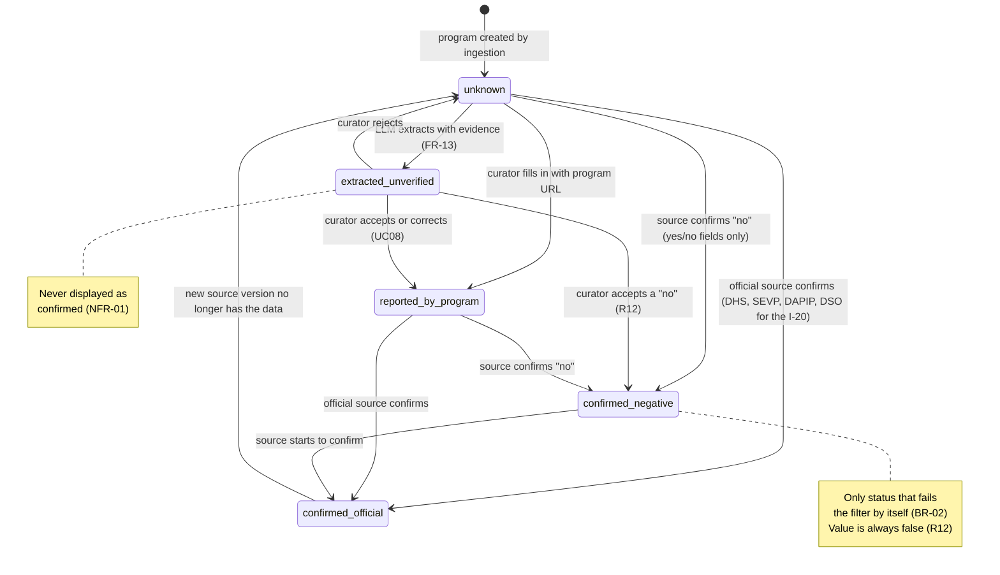

Every transition writes a row to `FieldChange` (author, date, old and new value). Ingestion transitions use the system author `ingest:<source>`. Ingestion **never downgrades** a value the curator verified (UC05, step 6): if the source disagrees, it opens a `ReconciliationTask`. A campus that matched SEVP before and is missing from a new list version also becomes a `ReconciliationTask`; it is never set to "not certified" automatically.

Which status a source gives (R11, R13):
- `confirmed_official`: a government list or file (DHS STEM list, SEVP list, IPEDS, DAPIP, HUD), usually `source_kind = official_list` or `uploaded_file`. For `immigration.i20_issued_for_program` only, the international office (DSO) also counts as official, through its official page (`page`) or a written reply (`correspondence`).
- `reported_by_program`: the program, department or school site, or a written reply from them other than the DSO on the I-20.

### 3.2 Review of an extraction (UC08)

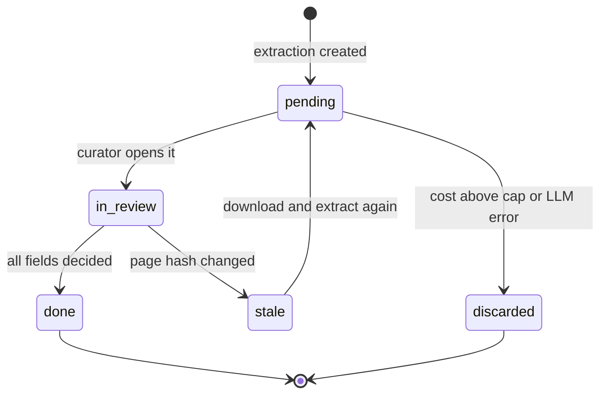

### 3.3 Coverage of a state / subdivision (BR-11, FR-11)

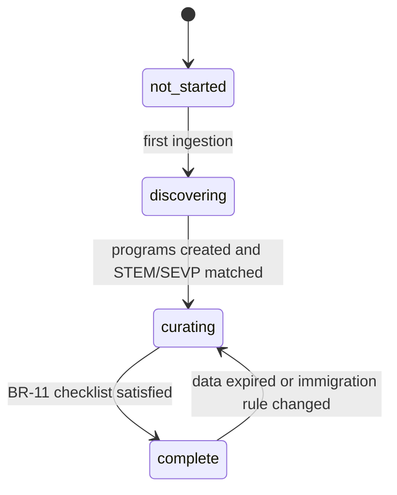

---

## 4. Activities: elimination filter (BR-04, FR-18)

The criteria come from the rules module of the program's country (`CountryRules.criteria`). The diagram shows those of the `us` module; the aggregation at the end belongs to the core and applies to any country.

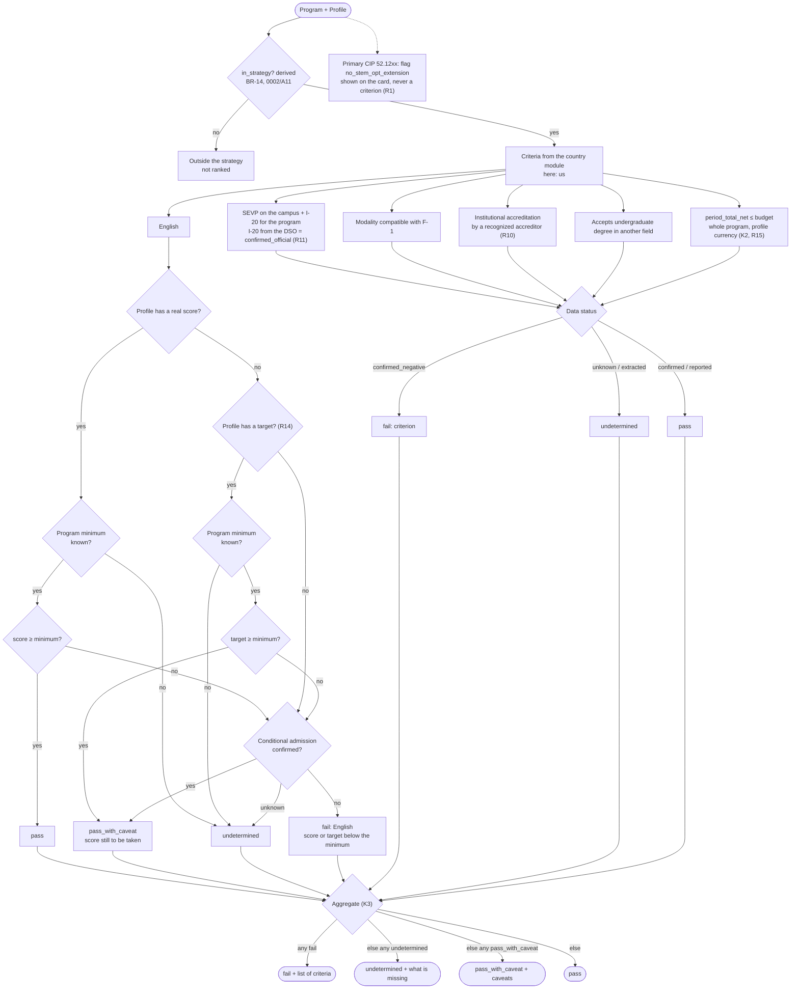

- **SEVP + I-20** (R11): SEVP certification is read from `Campus.intl_authorization`; the I-20 from `immigration.i20_issued_for_program`. The criterion fails if either is `confirmed_negative`. The I-20 counts as `confirmed_official` when the international office (DSO) says so on its official page or in a written reply; the department page alone is `reported_by_program`, which still passes the filter (but not the finalist gate, BR-06).
- **Accreditation** (R10): "institutional accreditation by a recognized accreditor" (US: an agency recognized by the Department of Education, checked in DAPIP). "Regional" is not shown.
- **English** (R14, K3): `pass_with_caveat` is a per-criterion outcome. A profile with no real score but a target passes against a known minimum with `pass_with_caveat`; a score or target below the minimum goes to the conditional-admission check, like a profile with neither (K8): confirmed conditional admission gives `pass_with_caveat`, unknown gives `undetermined`, and no gives `fail` with the reason "score or target below the minimum".
- **52.12** (R1): the flag `no_stem_opt_extension` does not fail the filter; it only changes the `post_study_work` score (12-month OPT) and the card.
- **Polarity** (R12): only yes/no fields can be `confirmed_negative`, so `gen` reads the "no" from the status, never from `confirmed_official + false`. Comparing a known value against the profile (English, cost) can also fail (BR-02 as reworded by 0002/A3).
- The cost criterion uses `CostEstimate.period_total_net` (guaranteed funding only, R15), already converted to the profile's currency and compared with the whole-program budget (K2). If any part is unknown, the result is undetermined, never pass.
- Aggregation order (K3): any `fail` → `fail`; else any `undetermined` → `undetermined`; else any `pass_with_caveat` → `pass_with_caveat`; else `pass`.
- The result always lists **all** criteria that failed, are missing or carry a caveat, not just the first one. That is what the screen shows (FR-18).
- The filter is a pure function `evaluate_filter(program, profile, rules) -> FilterResult`, with no I/O. Each box in the diagram becomes a test case in the `us` module; the aggregation has its own tests, independent of country.

---

## 5. Sequences

### 5.1 UC05 Import official sources (ingestion)

Every official file was uploaded first (§5.5, FR-26, R4). An ingestion run always processes one `SourceFile`. For a state, the files are processed in the order below, because later steps need what earlier steps created (R3).

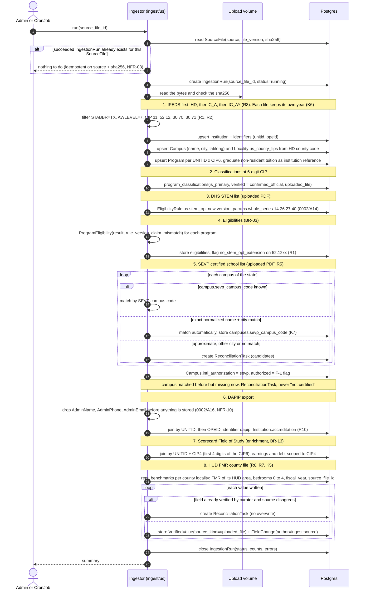

- **Upload, not download** (R4, K4). ice.gov, studyinthestates.dhs.gov and huduser.gov block scripts and nces.ed.gov is unreliable, so every source enters by upload. Automatic download is optional per source and never required. The CronJob (D7) runs only sources that allow automatic download (today: ECB rates, R8) and re-processes the latest uploaded files when rules change.
- **IPEDS is the primary discovery source** (R3): `HD<year>` (directory, county code, coordinates), `C<year>_A` (completions by UNITID × 6-digit CIP; `CNRALT` = graduates on temporary visas), `IC<year>_AY` (`TUITION7`, graduate non-resident tuition, an institution reference value, never "verified" for the program). A UNITID × CIP6 with 0 completions in the latest year becomes a program "to confirm", not published. Each file records its own year in `source_files.file_version` (K6); no rule requires matching years.
- **SEVP** (R5): exact name + city → automatic; anything else → `reconciliation_tasks`. Once confirmed, the campus code is stored on `campuses.sevp_campus_code` and later runs match by it. The 12-character SEVP school code is not unique and is never used as an identifier. Name-to-name matching is a US-specific exception and stays inside `ingest/us`.
- **HUD** (K5): HUD publishes FMR by FMR area, not by county. The locality stays the county (`us_county_fips`); the county file maps each county to its FMR area, and `rent_benchmarks` stores that area's FMR once per county. The county file's column names are still to be confirmed on the first download (`docs/sources/hud-fmr.md`). HUD files are downloaded once a year in a browser; no HUD account (R7).
- **Errors:** a source that fails mid-file closes the run as `failed` with the errors; the same `SourceFile` can be run again, and only a `succeeded` run blocks a re-run.

### 5.2 UC04 Configure profile and simulate

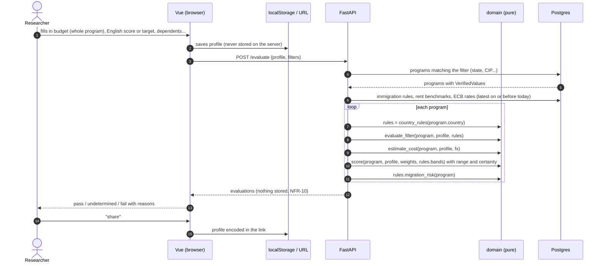

### 5.3 UC06 Curate program

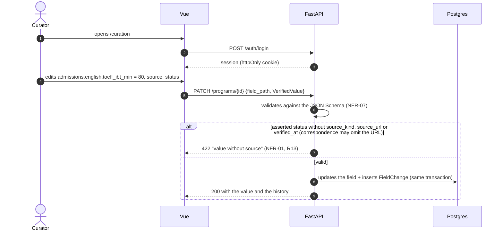

### 5.4 UC08 Review extraction

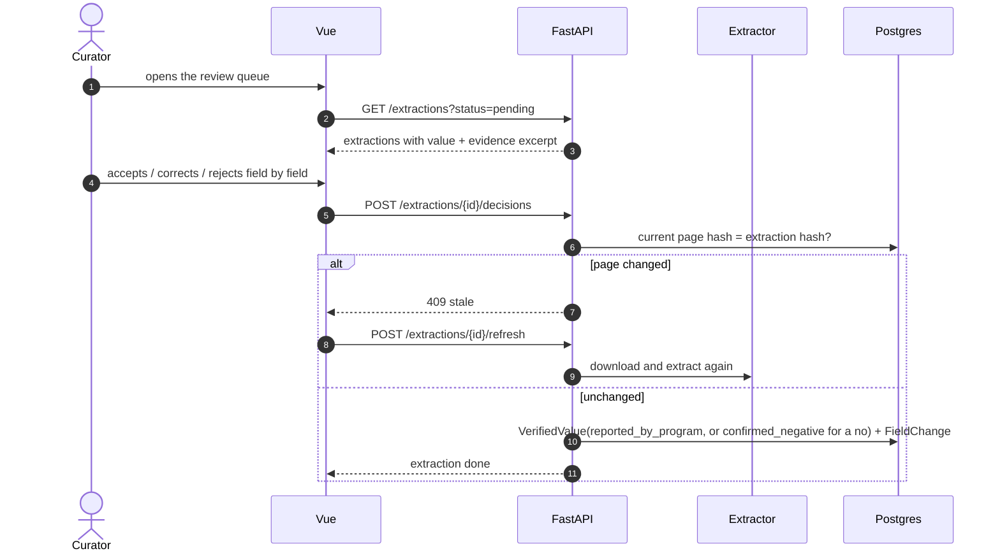

### 5.5 FR-26 Upload an official file (curation screen)

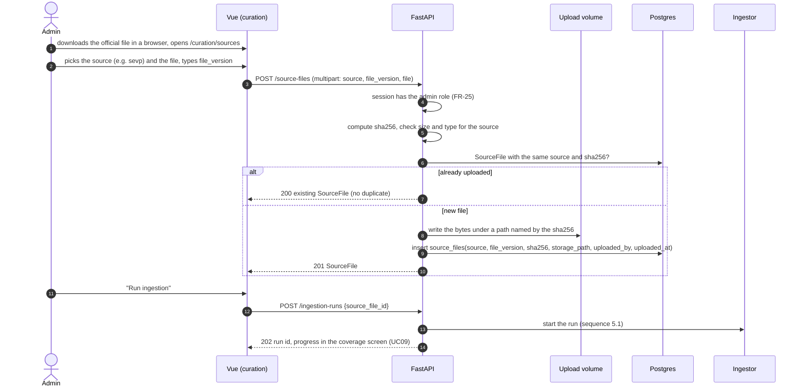

- Accepted sources: DHS STEM list PDF, SEVP PDF, IPEDS files (HD, C_A, IC_AY), Scorecard FoS file, DAPIP export, HUD FMR county file (R4).
- The file is the source of truth for the values it feeds: their `source_kind` is `uploaded_file` and `source_url` is the official download URL recorded with the upload.
- A DAPIP export is stored as uploaded, but its contact columns are never read into the database (0002/A16). The file bytes stay on the private volume and are never served by the public API.

---

## 6. Components

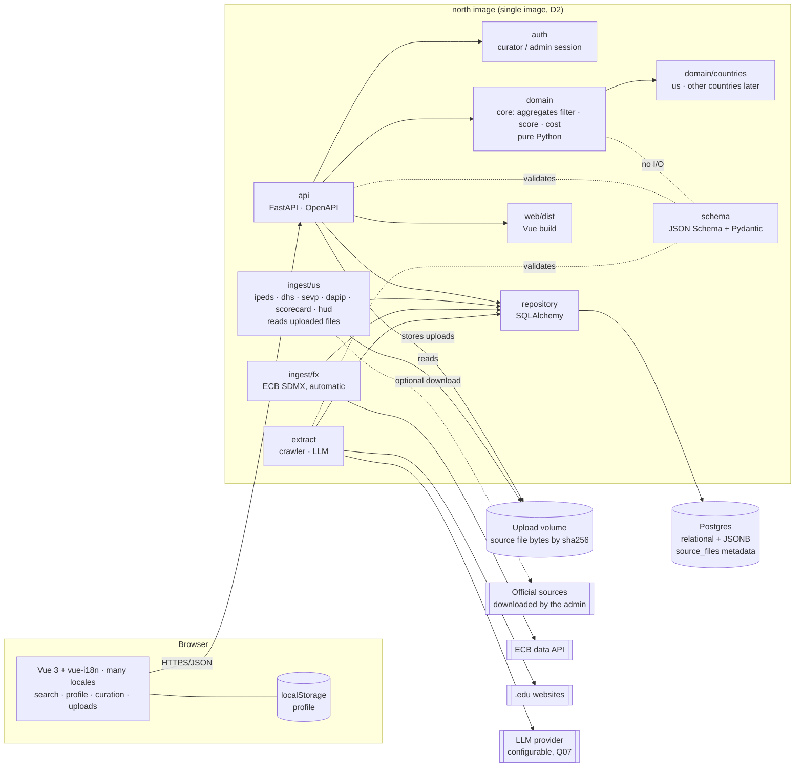

Dependency rules:
- `domain` imports nothing from `api`, `repository`, `ingest` or `extract`. This keeps the filter, score and cost testable without a database (NFR-08).
- The `domain` core knows no country. It talks to `domain/countries/<country>` only through the `CountryRules` interface.
- A new country = one module in `domain/countries/` + its ingestions in `ingest/<country>/`, with no data migration.

Uploaded files (R4, FR-26):
- **Choice: a DB table plus a volume.** The `source_files` table holds the metadata (source, file_version, sha256, storage path, uploader, date). The file bytes are stored **outside the database**, on a persistent volume mounted by the app and by the ingestion job, at a path named by the sha256. This keeps the database and its backups small (the IPEDS completions file alone is about 63 MB unzipped) and makes the same file impossible to store twice. Object storage was not chosen: the cluster has none today, and a volume is enough for a few files a year.
- `ingest/us` never downloads by default: it reads the bytes from the volume and checks the sha256 recorded in `source_files`. A per-source automatic download stays optional.
- The volume is private: no endpoint serves its files. The DAPIP export on it contains contact data that is never read into the database (0002/A16).

---

## 7. Deployment (k3s, C-08)

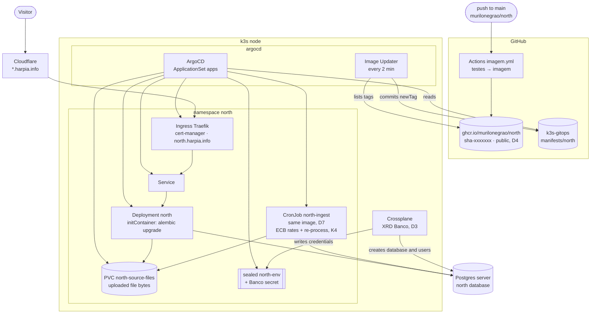

- The first deployment (D6) has only the Deployment, the Service and the Ingress, with `/health`. The database and the CronJob come in when steps 4 and 5 of `k3s-gitops` are ready and the backend needs a database (Phase 5 of the plan).
- The headers middleware follows the cluster's standard one, **without** `X-Robots-Tag: noindex` (D5).
- Database backup (NFR-16): pgBackRest on the Postgres server, already on the `k3s-gitops` "Later" list, must be ready before curated data enters production.
- Upload volume (FR-26): one PersistentVolumeClaim, `north-source-files`, mounted by the Deployment (writes uploads) and by the ingestion Job/CronJob (reads them). On the single-node k3s a ReadWriteOnce local-path volume works because both pods run on the same node; a second node would need ReadWriteMany or object storage. Back it up together with the database (NFR-16): old official files, such as a dated SEVP PDF, may disappear from the source site, and `source_files` rows point to them.

---

## 8. Physical model (ER)

```mermaid
erDiagram
  countries ||--o{ subdivisions : "has"
  countries ||--o{ localities : "has"
  subdivisions ||--o{ institutions : "has"
  institutions ||--o{ institution_identifiers : "identified by"
  institutions ||--o{ campuses : "has"
  localities ||--o{ campuses : "locates"
  campuses ||--o{ programs : "offers"
  programs ||--o{ program_identifiers : "identified by"
  accounts ||--o{ curation_slices : "created"
  institutions ||--o{ institution_contacts : "private contacts"
  localities ||--o{ rent_benchmarks : "has"
  source_files ||--o{ rent_benchmarks : "source"
  programs ||--o{ program_classifications : "classified"
  classifications ||--o{ program_classifications : "used by"
  classifications ||--o{ classification_maps : "source"
  classifications ||--o{ classification_maps : "target"
  countries ||--o{ eligibility_rules : "defines"
  source_files ||--o{ eligibility_rules : "source"
  eligibility_rules ||--o{ eligibility_rule_codes : "lists"
  classifications ||--o{ eligibility_rule_codes : "eligible"
  programs ||--o{ program_eligibilities : "has"
  eligibility_rules ||--o{ program_eligibilities : "applies"
  countries ||--o{ migration_rules : "has"
  programs ||--o{ field_changes : "history"
  accounts ||--o{ field_changes : "author"
  accounts ||--o{ source_files : "uploaded"
  programs ||--o{ raw_pages : "has"
  raw_pages ||--o{ extractions : "produces"
  extractions ||--o{ extracted_fields : "contains"
  source_files ||--o{ ingestion_runs : "ingested by"
  ingestion_runs ||--o{ reconciliation_tasks : "opens"

  countries {
    text code PK "ISO 3166-1"
    text name
    text currency "ISO 4217"
    text rules_module "us"
  }
  subdivisions {
    text id PK "ISO 3166-2, US-TX"
    text country_code FK
    text name
    text coverage_status
  }
  localities {
    bigint id PK
    text country_code FK
    text scheme UK "us_county_fips, ie_cso_riq02, ie_county"
    text code UK "48453, unique per country and scheme"
    text name "Travis County"
  }
  institutions {
    text id PK "slug"
    text subdivision_id FK
    text name
    text city
    text control
    jsonb accreditation "VerifiedValue: accreditor, scheme, institutional"
    jsonb carnegie_classification "VerifiedValue, 0002/A12"
  }
  institution_identifiers {
    bigint id PK
    text institution_id FK
    text scheme UK "unitid, opeid, dapip, ror, ie_provider_no"
    text value UK "unique per scheme and value"
  }
  program_identifiers {
    bigint id PK
    text program_id FK
    text scheme UK "ie_ilep_ref, ie_trusted_ref, ie_irq"
    text value UK "unique per scheme and value"
  }
  campuses {
    bigint id PK
    text institution_id FK
    text name
    text city
    bigint locality_id FK
    text sevp_campus_code UK "nullable, R5, K7"
    numeric latitude
    numeric longitude
    jsonb intl_authorization "VerifiedValue: scheme, authorized"
  }
  rent_benchmarks {
    bigint id PK
    bigint locality_id FK
    text source "hud_fmr, cso_riq02"
    text period "FY2027, 2025Q4"
    int bedrooms "0 to 4"
    numeric amount "monthly"
    text currency
    bigint source_file_id FK
  }
  programs {
    text id PK "slug"
    bigint campus_id FK
    text name
    text kind "degree, language_course"
    jsonb level "VerifiedValue: isced_level, credential"
    text degree
    jsonb intl_authorization "VerifiedValue, program level (ie), T5"
    jsonb language_course "cefr_entry, cefr_exit, exam, weeks, hours_per_week, price, start_dates"
    bool in_strategy "derived, 0002/A11, never edited"
    jsonb flags "derived, no_stem_opt_extension"
    jsonb immigration "keys from the country module"
    jsonb academic
    jsonb cost "values with amount and currency"
    jsonb funding "available_to_masters + opportunities"
    jsonb admissions "deadlines: list of VerifiedValue"
    jsonb career
    jsonb family
    int schema_version
    timestamptz updated_at
  }
  classifications {
    int id PK
    text scheme UK "cip2020, isced_f_2013, us_ipeds_awlevel, ie_nfq"
    text code UK "11.0701"
    text title
  }
  program_classifications {
    text program_id FK
    int classification_id FK
    bool is_primary
    jsonb verified "VerifiedValue envelope, 0002/A7"
  }
  classification_maps {
    int from_id FK
    int to_id FK
    text origin "derived_official, proposed"
    bool partial
    text notes
  }
  eligibility_rules {
    int id PK
    text country_code FK
    text key "us.stem_opt"
    text version
    date published_on
    text source_url
    jsonb params "whole_series, 0002/A14"
    bigint source_file_id FK
  }
  eligibility_rule_codes {
    int rule_id FK
    int classification_id FK
  }
  program_eligibilities {
    text program_id FK
    int rule_id FK
    jsonb result "VerifiedValue of bool"
    text rule_version
    bool claim_mismatch
    timestamptz computed_at
  }
  fx_rates {
    bigint id PK
    text source "ecb"
    text base "EUR"
    text quote
    numeric rate
    date on_date
    text source_url
  }
  migration_rules {
    int id PK
    text country_code FK
    text key "us.grace_period_days"
    text summary
    date last_checked_at
    text source_url
    jsonb affects
  }
  field_changes {
    bigint id PK
    text program_id FK
    text field_path
    jsonb old_value
    jsonb new_value
    text author "account or ingest:source"
    timestamptz at
  }
  accounts {
    int id PK
    text email
    text password_hash
    jsonb roles
  }
  source_files {
    bigint id PK
    text source UK "sevp, dhs_stem, ipeds_hd, ipeds_c_a, ipeds_ic_ay, ipeds_ic_py, scorecard_fos, dapip, hud_fmr, ie_ilep, ie_trusted, ie_irq, cso_riq02"
    text sha256 UK "unique per source and sha256"
    text file_version "C2024_A, 2026-11-18"
    text original_name
    text storage_path "on the upload volume"
    bigint size_bytes
    text source_url "official download URL"
    int uploaded_by FK
    timestamptz uploaded_at
  }
  raw_pages {
    bigint id PK
    text program_id FK
    text url
    text content_hash
    text markdown
    timestamptz fetched_at
  }
  extractions {
    bigint id PK
    bigint raw_page_id FK
    text model
    int tokens
    numeric cost_usd
    text status
  }
  extracted_fields {
    bigint id PK
    bigint extraction_id FK
    text field_path
    jsonb value
    text evidence
    text decision
  }
  ingestion_runs {
    bigint id PK
    bigint source_file_id FK
    text status "running, succeeded, failed"
    timestamptz started_at
    timestamptz finished_at
    jsonb counts
    jsonb errors
  }
  reconciliation_tasks {
    bigint id PK
    bigint run_id FK
    text kind "sevp_match, sevp_missing, ie_list_move, value_conflict"
    text reason
    jsonb candidates
    bool resolved
  }
  institution_contacts {
    bigint id PK
    text institution_id FK
    text source "ie_ilep, ie_trusted, dapip, ipeds_hd"
    bigint source_file_id FK
    text name "private, admin only, record 0009"
    text title
    text email
    text phone
    timestamptz seen_at
  }
  curation_slices {
    bigint id PK
    text name UK
    text country_code FK
    jsonb filter "same keys as the listing filters"
    int created_by FK
    timestamptz created_at
  }
```

- Dimensions are stored as one JSONB column each (`admissions`, `cost`…), instead of a single JSONB. This allows indexing only what the listing filters on (NFR-02), for example `(admissions->'english'->'toefl_ibt_min'->>'value')::int`.
- **Location** (R17): `programs.campus_id` replaces the free-text `campus`; the institution is reached through the campus (`programs.institution_id` was dropped). `localities` has a unique constraint on `(country_code, scheme, code)`. In the US the locality is the county (`us_county_fips`).
- **Rent** (R6, K5): HUD publishes FMR by FMR area, not by county. `rent_benchmarks` stores, for each county locality, the FMR of the HUD area that contains it (taken from the HUD county file), one row per `(locality_id, source, fiscal_year, bedrooms)`. The cost uses bedrooms = ceil((1 + dependents) / 2), max 4 (a family of 5 → 3 bedrooms). The county file's column names are still to be confirmed.
- **SEVP** (R5, K7): `campuses.intl_authorization` replaces `institutions.intl_authorization`. `campuses.sevp_campus_code` is unique when not null and is filled once a match is confirmed; it is not an `institution_identifiers` scheme.
- **Identifiers:** unique constraint on `institution_identifiers(scheme, value)`. US ingestion matches by `unitid`/`opeid`; DAPIP adds `dapip` (0002/A15). Another country's ingestion matches by its own scheme. `ror` finds the same institution across sources from different countries.
- **Classifications:** unique constraint on `classifications(scheme, code)`. Each program has a primary code in the country's scheme (`is_primary`, US: 6-digit CIP from IPEDS) whose status and source are in `program_classifications.verified` (0002/A7). Through the map it also has an ISCED-F code. `classification_maps.origin` is `derived_official` (Statistics Canada pairs) or `proposed` (needs author review); `partial` marks a CIP class that is only part of the ISCED-F class (R9). The field filter uses ISCED-F when a search mixes countries and the local code when it covers a single country.
- **Eligibilities:** one row per rule version in `eligibility_rules`, with `params` (US STEM: `{"whole_series": ["14", "26", "27", "40"]}`, 0002/A14) and the uploaded list in `source_file_id`. `program_eligibilities.result` is a full `VerifiedValue` (0002/A8); `claim_mismatch` flags a program that claims STEM when its CIP disagrees. When a new version arrives (for example, a new DHS STEM list), that country's `program_eligibilities` are recomputed and the changes go to the history.
- **Money:** every value inside `cost` and `funding` is `{amount, currency}`, in addition to the `VerifiedValue`. Conversion is never stored in the program: it happens at evaluation time. `fx_rates` stores ECB EUR/xxx rates as published (`source = ecb`, unique on `(source, base, quote, on_date)`); cross rates go through EUR, using the latest rate on or before the requested date (R8). The converted value is returned with the rate date.
- **Round 3** (record 0008): `programs.kind` and `programs.level` are indexed for the listing (NFR-02 over about 280,000 programs). `program_identifiers` has a unique constraint on `(scheme, value)`; Irish ingestion matches ILEP and TrustEd rows by these refs and by `institution_identifiers.ie_provider_no`. ILEP contact names, emails and phones are dropped at read time and stored nowhere. `rent_benchmarks.period` replaces `fiscal_year` (HUD `FY2027`, CSO `2025Q4`); unique on `(locality_id, source, period, bedrooms)`. `subdivisions.coverage_status` is superseded by per-slice coverage computed from `curation_slices`.
- `field_changes` stores the full `VerifiedValue`, before and after. This is FR-09 and serves as the audit trail.
- **Uploads and idempotency** (R4, NFR-03): unique constraint on `source_files(source, sha256)`; the bytes are on the upload volume at `storage_path` (§6). Each IPEDS file records its own year in `file_version` (K6). `ingestion_runs.source_file_id` points to the file; a partial unique index on `ingestion_runs(source_file_id) WHERE status = 'succeeded'` stops the same file from being ingested twice, while a failed run can be repeated.
- **Personal data** (NFR-10, 0002/A16): DAPIP contact names, phones and emails are never stored in any table. Correspondence used as a source (R13) is stored outside the public tables; `VerifiedValue.evidence` never holds names or email addresses.

---

## Pending items

Resolved:
1. ~~Q09/Q10 (spikes) may change sequence 5.1.~~ Resolved by **R3** (IPEDS first, Scorecard as enrichment), **R4** (official files by upload, FR-26) and **R5** (SEVP matching by name + city, then by campus code). Sequence 5.1 rewritten; 5.5 added.
2. ~~CIP → ISCED-F map: check whether an official crosswalk exists.~~ Resolved by **R9**: no official CIP 2020 → ISCED-F table exists; Statistics Canada pairs are `derived_official`, new CIP 2020 codes are `proposed`. Scope CIPs updated by **R1/R2** (11.xx, 52.12xx flagged, 30.70xx, 30.71xx).
3. ~~Exchange rate source for `fx_rates`.~~ Resolved by **R8**: ECB only, SDMX API, cross rates through EUR.
4. ~~HUD needs a locality.~~ Resolved by **R6, R17, K5**: `localities`, `campuses`, `rent_benchmarks`.
5. ~~How unknown data enters the score.~~ Resolved by **R16** (neutral 50, `score_range`, `certainty`); bands live in the country module (**0002/A13**).

Still open (from record 0002):
1. The schema of each dimension (the fields inside `admissions`, `cost`…) will be revised with the manual pilot (Phase 4) into schema v1. Schema v0 already follows this model.
2. Review the 7 proposed CIP → ISCED-F rows.
3. Review the immigration risk criteria (0002/A10) and the score bands (0002/A13) with pilot data. The per-criterion formula (BR-05) is proposed in `docs/methodology/score-proposal.md`.
4. Check by hand the 8 Texas institutions with no SEVP match (and Strayer University: same name, different city).
5. Profile fields still missing: GPA and GRE; a parameter for non-housing family expenses.
6. Confirm the column names of the HUD county file on the first download (K5).
7. Check the proposed OPT fee rule (Federal Register 2026-20660) in `migration_rules` (0002/A16).

Open from record 0008:
8. Review the source code → ISCED level map (`us_ipeds_awlevel`, `ie_nfq`), as with R9.
9. Confirm the effective date of the fixed 4-year F-1 admission (8 CFR 214.2(f)(5)(i)) before adding it to `migration_rules` (T15).
10. QQI and SEVP replies (TrustEd terms, NFQ codes, English-training flag) (T8).
